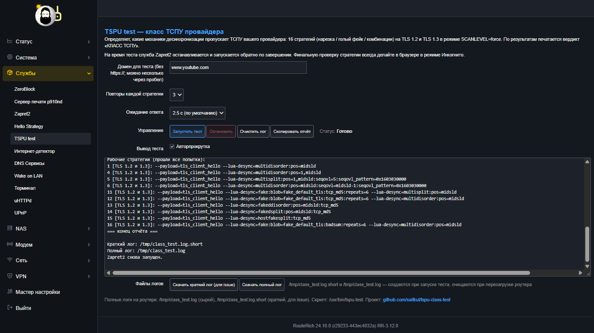
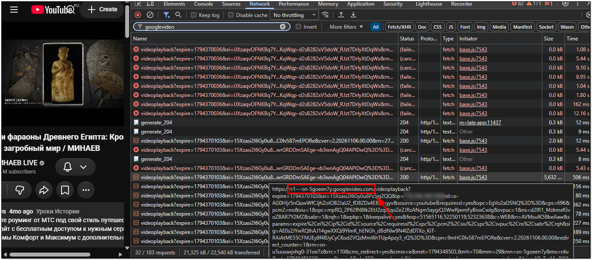
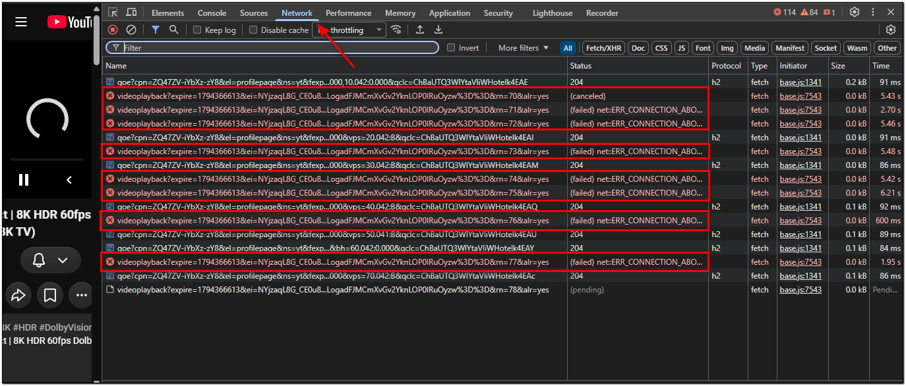

# 🔬 TSPU test — класс ТСПУ провайдера для Zapret2

*LuCI-приложение и CLI-скрипт экспресс-диагностики фильтрации ТСПУ вашего провайдера. За 5–20 минут объективно определяет, какие механики десинхронизации пропускает ваш ТСПУ, печатает готовый вердикт «КЛАСС ТСПУ» и формирует отчёт для карты провайдеров — вместо слепого перебора чужих конфигов.*



## 🎯 Зачем это нужно?

Вместо копирования чужих тяжёлых публичных стратегий вы получаете объективную картину: какие приёмы ваш ТСПУ пропускает, а какие блокирует. Это позволяет выбрать индивидуальную, минимально достаточную стратегию, снизить нагрузку на роутер и ускорить работу сервисов. А если мы соберём результаты из разных городов — получится **карта фильтрации по стране**: какому провайдеру что подходит на данный момент.

## ⚡ Что умеет приложение?

| Возможность | Описание |
|---|---|
| **16 стратегий в 3 группах** | нарезка без фейков (1–6) / голый фейк с разными фулингами (7–10) / фейк + нарезка (11–16) — техника и «дурка» разделены, видно, что именно работает |
| **Вердикт «КЛАСС ТСПУ»** | по результатам автоматически печатается класс: L0 / L0- / L2 / «особый» / «не определён» — с расшифровкой и рекомендацией |
| **LuCI-интерфейс** | запуск, остановка, живой вывод, подсветка вердикта, раскраска попыток — без терминала |
| **Авто-повтор при «не определён»** | если строки флапнули (нестабильно/медленно) — тест сам повторяется с ожиданием 8 с и повторами 5 (галочка, отключается) |
| **Скачивание логов кнопками** | краткий лог (для issue) и полный — прямо из браузера |
| **«Скопировать отчёт»** | блок отчёта для issue #1 копируется в буфер одной кнопкой |
| **Несколько доменов** | основной сайт и узел видеопотока googlevideo.com проверяются отдельными прогонами — медиа-узлы ТСПУ часто фильтрует иначе |
| **Безопасность** | временные файлы только в `/tmp`; служба `zapret2` на время теста останавливается и запускается обратно (по завершении, при остановке и при удалении пакета); конфигурация Zapret2 не изменяется |

Ядро теста — [tspu-class-test v2.2](https://github.com/saitkul/tspu-class-test): 16 стратегий, `SCANLEVEL=force` (стратегии проверяются всегда, даже если домен открывается без обхода), версии `curl` и `nfqws2` в отчёте.

## 🖥️ Способ запуска через LuCI-приложение

Службы → **TSPU test**: форма с доменом, повторами и ожиданием, кнопки управления, вердикт с подсветкой, блок «Попытки» с раскраской (зелёный — стабильно, оранжевый — нестабильно, серый — ноль), скачивание логов и копирование отчёта.


## 📦 Установка

Требования: OpenWrt 23.05/24.x или 25.x, установленный [Zapret2](https://github.com/bol-van/zapret) в `/opt/zapret2` (с `blockcheck2.sh`), `curl`, LuCI.

### OpenWrt 23.05 / 24.x (opkg)
```bash
opkg install https://github.com/saitkul/tspu-class-test/raw/main/luci-app-tspu-test_1.1.4-1_all.ipk
```
Или через LuCI: **Система → Программное обеспечение → Загрузить пакет**.

### OpenWrt 25.x (apk) — экспериментально
```bash
apk add --allow-untrusted https://github.com/saitkul/tspu-class-test/raw/main/luci-app-tspu-test-1.1.4-r1.apk
```

### Удаление
```bash
opkg remove luci-app-tspu-test    # или: apk del luci-app-tspu-test
# или: sh uninstall.sh
```
Удаление останавливает идущий тест (Zapret2 возвращается) и чистит временные файлы `/tmp`.

## 🚀 Как провести тест

1. **LuCI → Службы → TSPU test** → домен по умолчанию `www.youtube.com`, повторы `3`, ожидание `2.5 с` → **«Запустить тест»**.
2. Ждите 5–10 минут. Статус покажет «Идёт тест: N из 32» (16 стратегий × 2 протокола), попытки — в выводе.
3. После завершения читайте **Вердикт** и **ОТЧЁТ**. Кнопки: «Скопировать отчёт» (в буфер) и «Файлы логов» (скачать краткий/полный лог).

Повторный запуск с параметрами через CLI:

```bash
tspu-test start [ДОМЕН(Ы)] [ПОВТОРОВ] [ОЖИДАНИЕ_С]
tspu-test start www.youtube.com 3 5   # тест на узле видеопотока
tspu-test stop | status | log | clearlog
```

> 💡 **Несколько доменов** — каждый тестируется отдельным прогоном blockcheck2: приложение само разобьёт список и сведёт результаты в один отчёт с секциями по доменам.

## 💻 Клиенты для ПК (Windows / Linux / macOS) — без установки пакета

Если на роутере не OpenWrt или нельзя ставить пакеты — ядро теста можно запускать **с компьютера**: клиент сам заливает его на роутер по SSH, ведёт живой прогресс и возвращает отчёт. Требуется только Zapret2 в `/opt/zapret2` (curl + nfqws2) и доступ по SSH; пакет `luci-app-tspu-test` не нужен.

| Файл | Для |
|---|---|
| [TSPU-test-client-Windows.bat](https://github.com/saitkul/tspu-class-test/releases/download/v3.1.0-clients/TSPU-test-client-Windows.bat) | Windows 10/11 — двойной клик; при первом запуске предложит установить модуль Posh-SSH (нужен интернет один раз) |
| [tspu-test-client-linux-macos.sh](https://github.com/saitkul/tspu-class-test/releases/download/v3.1.0-clients/tspu-test-client-linux-macos.sh) | Linux и macOS — `chmod +x` и запуск; нужны `ssh` + `expect` (в macOS встроен; Linux: `apt install expect` / `dnf` / `pacman`) |

Возможности:

- адрес роутера запоминается (Enter = последний), логин по умолчанию `root`; **пароль не хранится**;
- домен(ы) через пробел (мульти-домен — каждый отдельным прогоном), повторы 1–5, ожидание 2.5/5/8/15 — спрашиваются перед тестом (Enter = значения по умолчанию);
- живой прогресс «Стратегий проверено: N из 32»;
- отчёт от «=== ИТОГ» до «=== конец отчёта ===» (все домены) — в буфер обмена и в файл;
- краткий и полный логи blockcheck — в папку результатов рядом с клиентом;
- на время теста Zapret2 останавливается и запускается обратно по завершении;
- загрузка ядра адаптивная: base64 (если есть) или текстом через heredoc; запуск с fallback без nohup.

> 💡 Видео тестируется по **отдельному узлу** `rr1---sn-….googlevideo.com` (DevTools → Network → фильтр `googlevideo` → `videoplayback`); корневой `googlevideo.com` обычно закрыт наглухо.

Скачивание — в [релизе v3.1.0-clients](https://github.com/saitkul/tspu-class-test/releases/tag/v3.1.0-clients).

## 🎥 Проверка узла видеопотока googlevideo

Видеопоток идёт не с `www.youtube.com`, а с отдельных узлов `*.googlevideo.com` — **ТСПУ часто фильтрует их иначе (или жёстче)**. Если сайт открывается, а видео тормозит или не стартует — проверьте узел:

1. Откройте любое видео YouTube, нажмите **F12 → Network**, в фильтр введите `googlevideo`.
2. Наведите курсор на запрос `videoplayback…` — в подсказке увидите URL:



3. Скопируйте первую часть URL до `/videoplayback` — это узел, например `rr1---sn-xxxx.googlevideo.com`.
4. Запустите **отдельный прогон**, вписав в поле домена только этот узел.

Красные обрывы `videoplayback … ERR_CONNECTION_ABORTED` в DevTools — прямое указание на то, что медиа-узел стоит проверить:



## 📊 Расшифровка результатов (16 строк, 3 группы)

| № | Стратегия | Что проверяет |
|---|---|---|
| 1–6 | **чистая нарезка без фейков** | 1 — `multidisorder:pos=midsld` (обратный порядок); 2 — `multisplit:pos=midsld` (прямой); 3 — `multidisorder:pos=sld` (граница SLD); 4 — `multidisorder:pos=1,midsld`; 5 — `multisplit` + `seqovl`; 6 — `multidisorder` + `seqovl` |
| 7–10 | **голый фейк без нарезки** | 7 — `tcp_md5`; 8 — `ip_autottl` (TTL); 9 — `badsum`; 10 — `tcp_md5` + подмена SNI (`tls_mod=rnd,rndsni,dupsid`) |
| 11–16 | **фейк + нарезка** | 11 — md5 + `multisplit`; 12 — md5 + `multidisorder`; 13 — `fakeddisorder`; 14 — `fakedsplit`; 15 — `hostfakesplit` (подмена имени); 16 — `badsum` + `multidisorder` |

Ядро печатает готовый **вердикт «КЛАСС ТСПУ»** по каждому протоколу:

| Вердикт | Что означает | Что закладывать в стратегию |
|---|---|---|
| **L0-** | нарезка пробивает без фейков; чистый multisplit ТСПУ склеивает — прямому помогает seqovl | минимальный `multidisorder:pos=midsld` (+ seqovl как страховка) |
| **L0** | обратный порядок пробивает, прямой склеивается | достаточно `multidisorder` |
| **L2** | нарезка работает только вместе с фейком | фейк (md5/badsum — по прошедшим строкам) + нарезка |
| **особый** | ТСПУ верит голому фейку, но режет нарезку | фулинг из прошедших строк (7–10) |
| **аномалия** | прямой разрез пробивает, обратный собирается | опора на `multisplit`/`seqovl` |
| **не определён** | строки флапнули (нестабильно/медленно) | приложение само предложит повтор с ожиданием 8 с и повторами 5 |

> ⚠️ **curl ≠ браузер.** На роутере curl обычно собран с mbedTLS без kyber — ClientHello уходит одним пакетом, у браузеров hello двухпакетный и другой отпечаток (TLS Client Hello). Результаты нарезки переносятся на браузер **не 1:1** — финальную проверку всегда делайте в браузере в режиме **Инкогнито** (или `Ctrl+F5`). Приложение печатает это предупреждение в отчёте автоматически, если TLS-бэкенд curl без kyber.

## 📝 Отчёт для карты провайдеров

1. Кнопка **«Скопировать отчёт»** — блок отчёта уходит в буфер обмена.
2. Кнопки **«Скачать краткий лог» / «Скачать полный лог»** — файлы логов для спорных случаев.
3. Отправьте данные в [Issue #1](https://github.com/saitkul/tspu-class-test/issues/1), обязательно указав **провайдер** и **город**.

**Пример карточки провайдера** (реальные данные):

```text
Провайдер: ... — 2026-11-11
Роутер: Routerich AX3000 v1, RouteRich 24.10.8
Стабильно (TLS 1.2 и 1.3): 1 4 5 6 11 12 13 14 15 16
Не прошли: 2 (multisplit), 3 (sld), 7–10 (голые фейки)
Класс: L0- — нарезка пробивает, чистый multisplit склеивается,
       прямому разрезу помогает seqovl
Рабочая: --payload=tls_client_hello --lua-desync=multidisorder:pos=midsld
Важно: медиа-узлы googlevideo.com фильтруются жёстче сайта —
       нарезкой на них не пробиваются (проверено 2 узлами)
```

## 📱 Использование AI для формирования персональной стратегии

Передайте вердикт `ИТОГ` / `ОТЧЁТ` и логи нейросети (NotebookLM, ChatGPT, ZCode, Claude и т.п.). Для лучшего результата обучите модель справочными материалами по Zapret2: [manual.md](https://raw.githubusercontent.com/bol-van/zapret2/refs/heads/master/docs/manual.md), [архив статей wiki](https://jzesawgjsz.zapret.moe/llms-full.txt), [ссылки на Wiki](https://zapret2-guide.pages.dev/).

**Пример промта:**
> *«Ты — эксперт в области сетевых технологий. Тщательно изучи технологию Zapret2 для формирования стратегий. Используй результаты ТЕСТА НА КЛАСС ТСПУ (вердикт и отчёт ниже), а также логи для создания нескольких вариантов оптимальных индивидуальных стратегий для ТСПУ моего провайдера.»*

## 📁 Файлы и пути

| Путь | Назначение |
|---|---|
| `/usr/bin/tspu-test` | CLI: `start [ДОМЕН(Ы)] [ПОВТОРОВ] [ОЖИДАНИЕ]` / `stop` / `status` / `log` / `clearlog` |
| `/usr/lib/lua/luci/controller/tspu-test.lua` | контроллер LuCI |
| `/usr/lib/lua/luci/view/tspu-test/test.htm` | страница LuCI (серверный шаблон) |
| `/usr/share/luci/menu.d/luci-app-tspu-test.json` | пункт меню «Службы → TSPU test» |
| `/usr/share/rpcd/acl.d/luci-app-tspu-test.json` | права доступа |
| `/tmp/class_test.log` / `.short` | полный / краткий лог blockcheck2 |
| `/tmp/tspu_test_run.log` | вывод приложения (что видно в LuCI) |

## ⚠️ Важные нюансы

* Тест проверяет сетевую доступность утилитой `curl` с mbedTLS — у браузеров другой отпечаток (TLS Client Hello, kyber). **Строки с `seqovl` могут проходить тест, но ломать браузеры** — финальную проверку всегда делайте в браузере в режиме **Инкогнито** (`Ctrl+F5`).
* **Медиа-узлы googlevideo.com часто фильтруются жёстче сайта**. Проверяйте узел отдельно — см. раздел 🎥.
* Ошибки DNS (`MISMATCH` в логе) при наличии ZeroBlock/прокси — обычно это FakeIP-стаб, тест сам переключается на DoH.
* Тест занимает 5–10 минут на домен (несколько доменов — дольше: каждый прогоняется отдельно). Не закрывайте браузер — тест идёт на роутере; можно остановить кнопкой.

## 🧰 Состав репозитория

| Путь | Что это |
|---|---|
| `luci-app-tspu-test_…_all.ipk` | пакет для OpenWrt 23.05/24.x (opkg) |
| `luci-app-tspu-test-…r1.apk` | пакет для OpenWrt 25.x (apk, экспериментально) |
| `install.sh` / `uninstall.sh` | универсальная установка/удаление |
| `docs/` | скриншоты |

## 🙏 Обратная связь

Нашли баг, хотите предложить функцию или поделиться результатом — [Предложения и баги](https://github.com/saitkul/tspu-class-test/issues/8) ждём ваши предложения.
