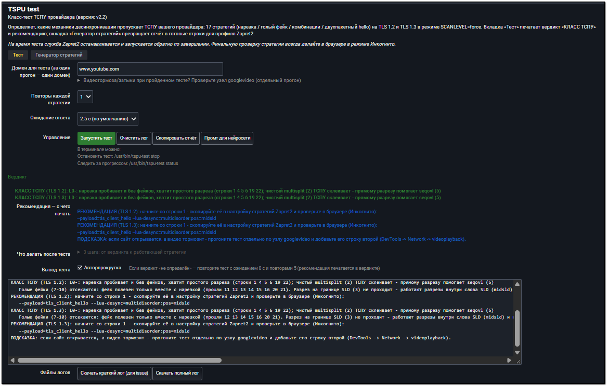
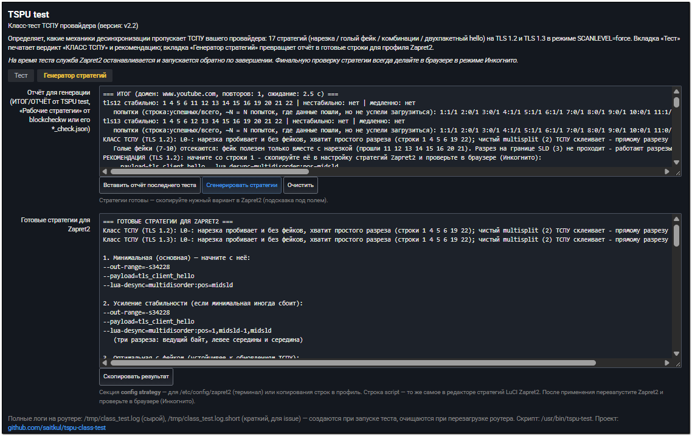
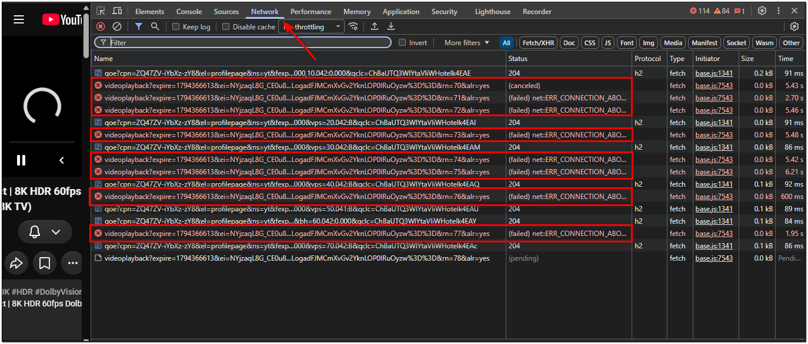

# 🔬 TSPU test — класс ТСПУ провайдера для Zapret2

*Экспресс-диагностика фильтрации ТСПУ вашего провайдера: за 5–20 минут объективно определяет, какие механики десинхронизации пропускает ваш ТСПУ, печатает готовый вердикт «КЛАСС ТСПУ» и **сам генерирует готовые стратегии** для Zapret2 — вместо слепого перебора чужих конфигов.*

Проект состоит из **двух компонентов** — выберите свой:

| | Продукт | Платформа | Актуальная версия |
|---|---|---|---|
| 🧰 | **LuCI-приложение для роутера** — тест прямо из панели OpenWrt + генератор стратегий | OpenWrt 23.05/24.x (ipk), 25.x (apk) | [**v2.3**](https://github.com/saitkul/tspu-class-test/releases/tag/v2.3) — Latest |
| 💻 | **Клиенты для ПК** — тест с компьютера, пакет на роутер не нужен | Windows / Linux / macOS | [**v2.0**](https://github.com/saitkul/tspu-class-test/releases/tag/v2.0-clients) — TCP- и QUIC-тесты |

> **Навигация по релизам:** релизы приложения для роутера — теги `vX.Y` (v1.1.2 → … → v2.3); релизы клиентов для ПК — теги `vX.Y-clients` (v2.0-clients, v3.1.0-clients). Актуальный релиз всегда помечен меткой **Latest**.



## 🎯 Зачем это нужно?

Вместо копирования чужих тяжёлых публичных стратегий вы получаете объективную картину: какие приёмы ваш ТСПУ пропускает, а какие блокирует. Это позволяет выбрать индивидуальную, минимально достаточную стратегию, снизить нагрузку на роутер и ускорить работу сервисов. А если мы соберём результаты из разных городов — получится **карта фильтрации по стране**: какому провайдеру что подходит на данный момент.

## 🧰 LuCI-приложение для роутера (v2.3)

| Возможность | Описание |
|---|---|
| **31 стратегия в 6 группах** | нарезка без фейков (1–6) / голые фейки (7–10) / фейк + нарезка (11–16) / двухпакетный hello (17) / комбо дробилки (18–23) / шумовая серия дробилки (24–31: дозы badsum-пар repeats 2/4/6, позиции 2/3, двухсторонние дробилки целиком) |
| **Вердикт «КЛАСС ТСПУ»** | печатается сам, с расшифровкой, **отдельно для TLS 1.2 и TLS 1.3** (они могут различаться), и дополнен «Рекомендацией — с чего начать»: одна конкретная готовая строка |
| **Генератор стратегий** | вставляете отчёт (или подставляете последний одной кнопкой) — получаете **6–7 готовых вариантов** (включая Дробилку-Лайт со сниженной дозой шума) профиля Zapret2: минимальная / усиление / с фейком / лестница до 9 ступеней из ваших прошедших строк / Дробилка (адаптируется под отчёт) / Универсальная лестница |
| **Распознавание флапающего профиля** | «данные идут, но не успевают» — совет начинать с лестницы или дробилки |
| **Понимает чужие отчёты** | TSPU test, сырой лог blockcheck2, blockcheckw и его `*_check.json` |
| **LuCI-интерфейс** | запуск, остановка, живой вывод, подсветка вердикта, раскраска попыток — без терминала |
| **Авто-повтор при «не определён»** | если строки флапнули — тест сам повторяется с ожиданием 8 с и повторами 5 |
| **Логи и отчёт кнопками** | краткий лог (для issue), полный лог, копирование отчёта в буфер |
| **Деавторизация после установки** | панель сама завершает сессию и просит войти заново — интерфейс гарантированно обновляется |
| **Безопасность** | временные файлы только в `/tmp`; служба `zapret2` на время теста останавливается и запускается обратно; конфигурация Zapret2 не изменяется |

**Вкладка «Тест»** — скриншот выше. **Вкладка «Генератор стратегий»** — вставляете отчёт (кнопка «Вставить отчёт последнего теста»), получаете 6 готовых вариантов и копируете выбранный в Zapret2:



## 📦 Установка приложения (роутер)

Требования: OpenWrt 23.05/24.x или 25.x, установленный [Zapret2](https://github.com/bol-van/zapret2) в `/opt/zapret2` (с `blockcheck2.sh`), `curl`, LuCI.

**Способ 1 — команда (скачает актуальный пакет из последнего релиза):**

```bash
# OpenWrt 23.05/24.x (opkg)
opkg install --force-reinstall https://github.com/saitkul/tspu-class-test/releases/latest/download/luci-app-tspu-test.ipk

# OpenWrt 25.x (apk)
apk add --allow-untrusted https://github.com/saitkul/tspu-class-test/releases/latest/download/luci-app-tspu-test.apk
```

**Способ 2 — через LuCI:** [релиз v2.3](https://github.com/saitkul/tspu-class-test/releases/tag/v2.3) → скачайте `luci-app-tspu-test_2.3_all.ipk` (24.x) или `luci-app-tspu-test-2.3.apk` (25.x) → **Система → Программное обеспечение → Загрузить пакет**.

**Способ 3 — install.sh:** положите пакет рядом с `install.sh` и запустите `sh install.sh` — сам определит менеджер (opkg/apk).

> После установки панель LuCI попросит войти заново — это обязательная деавторизация, интерфейс гарантированно обновится. Если страница выглядит по-старому — Ctrl+F5.

**Удаление:**
```bash
opkg remove luci-app-tspu-test    # или: apk del luci-app-tspu-test
# или: sh uninstall.sh
```

## 🚀 Как провести тест

1. **LuCI → Службы → TSPU test** → домен по умолчанию `www.youtube.com`, повторы `3`, ожидание `2.5 с` → **«Запустить тест»**.
2. Ждите 5–15 минут: статус покажет «Идёт тест: N из 62» (31 стратегия × 2 протокола), попытки — в выводе.
3. После завершения читайте **Вердикт** (отдельно для TLS 1.2/1.3) и **ОТЧЁТ**; кнопки: «Скопировать отчёт», «Файлы логов».
4. Откройте **Генератор стратегий** → «Вставить отчёт последнего теста» → «Сгенерировать стратегии» → получите 6 готовых вариантов. Выберите свой и вставьте в профиль Zapret2 (подсказка first-match-wins прямо в выводе).

CLI повторного запуска:
```bash
tspu-test start [ДОМЕН] [ПОВТОРОВ] [ОЖИДАНИЕ_С]
tspu-test start rr1---sn-xxxx.googlevideo.com 3 5   # узел видеопотока — отдельный прогон
tspu-test stop | status | log | clearlog
```

## 💻 Клиенты для ПК (Windows / Linux / macOS) — без установки пакета

Если на роутере не OpenWrt или нельзя ставить пакеты — ядро теста можно запускать **с компьютера**: клиент сам заливает его на роутер по SSH, ведёт живой прогресс и возвращает отчёт. Требуется только Zapret2 в `/opt/zapret2` (curl + nfqws2) и доступ по SSH; пакет `luci-app-tspu-test` не нужен.

### TCP-тест — подбор стратегий (основной инструмент)

| Файл | Для |
|---|---|
| [TSPU-test-client-Windows-2.0.bat](https://github.com/saitkul/tspu-class-test/releases/download/v2.0-clients/TSPU-test-client-Windows-2.0.bat) | Windows 10/11 — двойной клик; при первом запуске предложит установить модуль Posh-SSH (нужен интернет один раз) |
| [tspu-test-client-linux-macos-2.0.sh](https://github.com/saitkul/tspu-class-test/releases/download/v2.0-clients/tspu-test-client-linux-macos-2.0.sh) | Linux и macOS — `chmod +x` и запуск; нужны `ssh` + `expect` (в macOS встроен; Linux: `apt install expect` / `dnf` / `pacman`) |

Возможности: адрес роутера запоминается (**пароль не хранится**), домены и параметры спрашиваются перед тестом, 23 стратегии, живой прогресс, отчёт в буфер и в файл, логи blockcheck в папку результатов; на время теста Zapret2 останавливается и запускается обратно.

### QUIC-тест (UDP/HTTP3) — нишевый инструмент

Отдельные клиенты проверяют, **блокирует ли провайдер UDP 443 (QUIC/HTTP3)** к домену и пробивается ли это тестовым корпусом (56 QUIC-стратегий). Это **не замена** TCP-тесту — нужен, когда: в браузере видео тормозит при работающей TCP-стратегии; хотите понять, режется ли UDP к медиа-узлам; собираете картину провайдера.

| Файл | Для |
|---|---|
| [TSPU-quic-test-client-Windows.bat](https://github.com/saitkul/tspu-class-test/releases/download/v2.0-clients/TSPU-quic-test-client-Windows.bat) | Windows 10/11 — двойной клик |
| [TSPU-quic-test-client-linux-macos.sh](https://github.com/saitkul/tspu-class-test/releases/download/v2.0-clients/TSPU-quic-test-client-linux-macos.sh) | Linux и macOS — `chmod +x` и запуск; нужны `ssh` + `expect` |

Нюансы: клиент сам ставит QUIC-ядро и h3-curl (9,6 МБ) за секунды, с проверкой md5; вердикт «КЛАСС ТСПУ (QUIC)»; тестовый curl имеет фингерпринт ngtcp2 ≠ Chrome QUIC — «не пробит корпусом» не всегда значит «QUIC не работает для браузера»; тест детектирует блокировку/прохождение, но **не измеряет скорость видео**.

Скачивание — в [релизе v2.0-clients](https://github.com/saitkul/tspu-class-test/releases/tag/v2.0-clients).

## 🎥 Проверка узла видеопотока googlevideo

Видеопоток идёт не с `www.youtube.com`, а с отдельных узлов `*.googlevideo.com` — **ТСПУ часто фильтрует их иначе (или жёстче)**. Если сайт открывается, а видео тормозит или не стартует — проверьте узел:

1. Откройте любое видео YouTube, нажмите **F12 → Network**, в фильтр введите `googlevideo`.
2. Наведите курсор на запрос `videoplayback…` — увидите URL вида `https://rr1---sn-xxxx.googlevideo.com/videoplayback`. **Узел опознавайте по домену, содержащему `.googlevideo.com`** — форма бывает разной (префикс перед `---` не всегда `rr`, номер бывает двузначным).
3. Скопируйте первую часть URL до `/videoplayback` — это узел.
4. Запустите **отдельный прогон**, вписав в поле домена только этот узел. Если узел сменится в DevTools (rr2, rr5…) — повторите с новым.

Красные обрывы `videoplayback … ERR_CONNECTION_ABORTED` в DevTools — прямое указание на то, что медиа-узел стоит проверить:



## 📊 Расшифровка результатов (31 строка, 6 групп)

| № | Стратегия | Что проверяет |
|---|---|---|
| 1–6 | **чистая нарезка без фейков** | 1 — `multidisorder:pos=midsld` (обратный порядок); 2 — `multisplit:pos=midsld` (прямой); 3 — `multidisorder:pos=sld` (граница SLD); 4 — `multidisorder:pos=1,midsld`; 5 — `multisplit` + `seqovl`; 6 — `multidisorder` + `seqovl` |
| 7–10 | **голый фейк без нарезки** | 7 — `tcp_md5`; 8 — `ip_autottl` (TTL); 9 — `badsum`; 10 — `tcp_md5` + подмена SNI (`tls_mod`) |
| 11–16 | **фейк + нарезка** | 11 — md5 + `multisplit`; 12 — md5 + `multidisorder`; 13 — `fakeddisorder`; 14 — `fakedsplit`; 15 — `hostfakesplit`; 16 — `badsum` + `multidisorder` |
| 17 | **двухпакетный hello** | `multisplit:pos=1` — двухпакетный ClientHello, как у браузеров (kyber); если проходит — ближе всего к браузерному поведению |
| 18–19 | **7-точечный шред** | разрезы по всем границам SNI сразу (`pos=1,sniext+1,host+1,midsld±2,endhost-1`): 18 — multisplit (прямой), 19 — multidisorder (обратный) |
| 20–21 | **badsum-пара (механика дробилки)** | badsum-фейк внутри нарезки + 7-шред: примеси сбивают классификацию ТСПУ; 20 — multisplit, 21 — multidisorder |
| 22 | **seqovl=1** | простой разрез с малым фиксированным оверлапом (без паттерна) |
| 23 | **двухсторонний шред** | `payload=all` — режется и ответ сервера (ServerHello), единственная строка, меряющая серверную сторону |
| 24–27 | **шумовая серия дробилки: дозы** | badsum-пары + 7-шред: лёгкая (repeats=2) и тяжёлая (repeats=6, pos=3) — сканер покажет, какая доза работает на вашем ТСПУ |
| 28–29 | **двухсторонняя дробилка целиком** | `payload=all` + badsum-пара + 7-шред — полный эквивалент универсальной дробилки, меряется сканом |
| 30–31 | **шум-проба без шреда** | тяжёлая доза badsum-примесей без нарезки — изолирует вклад примесей |

Ядро печатает готовый **вердикт «КЛАСС ТСПУ»** по каждому протоколу:

| Вердикт | Что означает | Что закладывать в стратегию |
|---|---|---|
| **L0-** | нарезка пробивает без фейков; чистый multisplit ТСПУ склеивает — прямому помогает seqovl | минимальный `multidisorder:pos=midsld` (+ seqovl как страховка) |
| **L0** | обратный порядок пробивает, прямой склеивается | достаточно `multidisorder` |
| **L2** | нарезка работает только вместе с фейком | фейк (md5/badsum — по прошедшим строкам) + нарезка |
| **особый** | ТСПУ верит голому фейку, но режет нарезку | фулинг из прошедших строк (7–10) |
| **аномалия** | прямой разрез пробивает, обратный собирается | опора на `multisplit`/`seqovl` |
| **не определён** | строки флапнули (нестабильно/медленно) | приложение само предложит повтор с ожиданием 8 с и повторами 5 |

> ⚠️ **curl ≠ браузер.** На роутере curl обычно собран с mbedTLS без kyber — ClientHello уходит одним пакетом, у браузеров hello двухпакетный и другой отпечаток. Результаты переносятся на браузер **не 1:1** — финальную проверку всегда делайте в браузере в режиме **Инкогнито** (или `Ctrl+F5`). Приложение печатает это предупреждение в отчёте автоматически.

## 📝 Отчёт для карты провайдеров

1. Кнопка **«Скопировать отчёт»** — блок отчёта уходит в буфер обмена.
2. Кнопки **«Скачать краткий лог» / «Скачать полный лог»** — для спорных случаев.
3. Отправьте данные в [Issue #1](https://github.com/saitkul/tspu-class-test/issues/1), обязательно указав **провайдер** и **город**.

**Пример карточки провайдера** (реальные данные):

```text
Провайдер: ... — 2026-11-11
Роутер: Routerich AX3000 v1, RouteRich 24.10.8
Стабильно (TLS 1.2 и 1.3): 1 4 5 6 11 12 13 14 15 16
Не прошли: 2 (multisplit), 3 (sld), 7–10 (голые фейки)
Класс: L0- — нарезка пробивает, чистый multisplit склеивается,
       прямому разрезу помогает seqovl
Рабочая: --payload=tls_client_hello --lua-desync=multidisorder:pos=midsld
Важно: медиа-узлы googlevideo.com фильтруются жёстче сайта —
       нарезкой на них не пробиваются (проверено 2 узлами)
```

## 📱 Использование AI для формирования персональной стратегии

В приложении есть кнопка **«Промт для нейросети»** — готовый запрос с вашим отчётом. Передайте его нейросети (NotebookLM, ChatGPT, ZCode, Claude и т.п.). Для лучшего результата обучите модель справочными материалами по Zapret2: [manual.md](https://raw.githubusercontent.com/bol-van/zapret2/refs/heads/master/docs/manual.md), [архив статей wiki](https://jzesawgjsz.zapret.moe/llms-full.txt), [ссылки на Wiki](https://zapret2-guide.pages.dev/).

**Пример промта:**
> *«Ты — эксперт в области сетевых технологий. Тщательно изучи технологию Zapret2 для формирования стратегий. Используй результаты ТЕСТА НА КЛАСС ТСПУ (вердикт и отчёт ниже), а также логи для создания нескольких вариантов оптимальных индивидуальных стратегий для ТСПУ моего провайдера.»*

## 📁 Файлы и пути (роутер)

| Путь | Назначение |
|---|---|
| `/usr/bin/tspu-test` | CLI: `start [ДОМЕН] [ПОВТОРОВ] [ОЖИДАНИЕ]` / `stop` / `status` / `log` / `clearlog` |
| `/usr/lib/lua/luci/controller/tspu-test.lua` | контроллер LuCI |
| `/usr/lib/lua/luci/view/tspu-test/test.htm` | страница LuCI (Тест + Генератор стратегий) |
| `/usr/share/luci/menu.d/luci-app-tspu-test.json` | пункт меню «Службы → TSPU test» |
| `/usr/share/rpcd/acl.d/luci-app-tspu-test.json` | права доступа |
| `/usr/share/tspu-test/version` | версия приложения |
| `/tmp/class_test.log` / `.short` | полный / краткий лог blockcheck2 |
| `/tmp/tspu_test_run.log` | вывод приложения (что видно в LuCI) |

## ⚠️ Важные нюансы

* Тест проверяет сетевую доступность утилитой `curl` с mbedTLS — у браузеров другой отпечаток (kyber). **Строки с `seqovl` могут проходить тест, но ломать браузеры** (особенно позиционные — `seqovl=midsld-1`); фиксированные (`seqovl=5`, `seqovl=1`) безопаснее. Финальную проверку всегда делайте в браузере в режиме **Инкогнито** (`Ctrl+F5`).
* **Медиа-узлы googlevideo.com часто фильтруются жёстче сайта**. Проверяйте узел отдельно — см. раздел 🎥 (только если по основному домену не помогло).
* **После любого изменения firewall перезапустите zapret2**: fw4 перегенерируется и стирает вставленные правила nfqws2.
* Ошибки DNS (`MISMATCH` в логе) при наличии ZeroBlock/прокси — обычно это FakeIP-стаб (198.18.x.x), тест сам переключается на DoH.
* Тест занимает 5–15 минут на домен. Не закрывайте браузер — тест идёт на роутере; можно остановить кнопкой.

## 🧰 Состав репозитория

| Путь | Что это |
|---|---|
| `apk-data/` | дерево файлов приложения (собирается в ipk/apk) |
| `.github/workflows/build-apk.yml` | сборка .apk через Actions |
| `install.sh` / `uninstall.sh` | универсальная установка/удаление (opkg или apk — сам определит) |
| `docs/` | скриншоты |

Пакеты скачиваются из [Releases](https://github.com/saitkul/tspu-class-test/releases) — актуальные всегда в релизе с меткой **Latest**.

## 🙏 Обратная связь

Нашли баг, хотите предложить функцию или поделиться результатом — [Предложения и баги](https://github.com/saitkul/tspu-class-test/issues/8) ждём ваши предложения.
