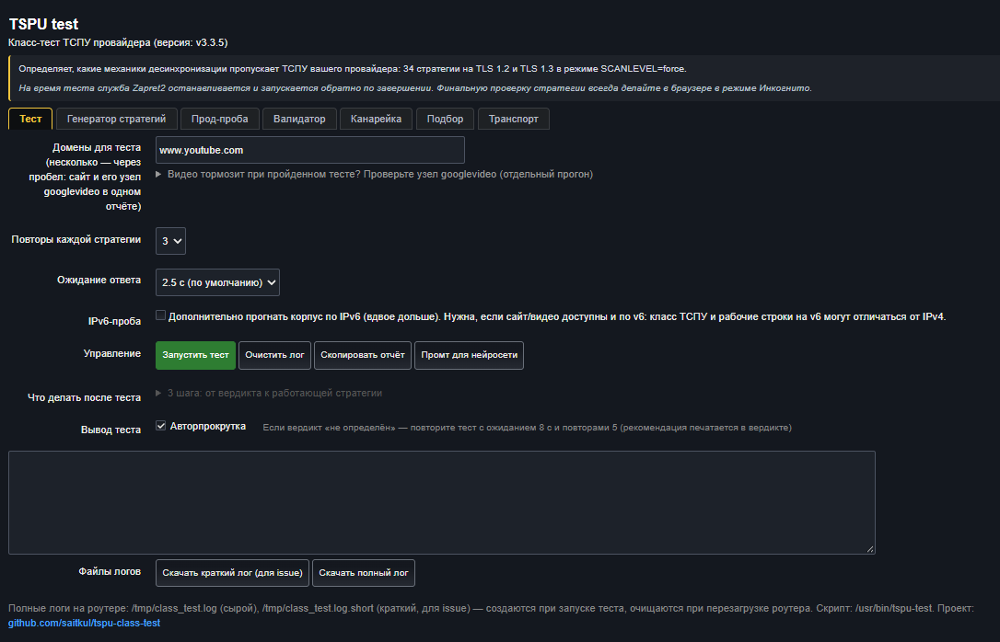
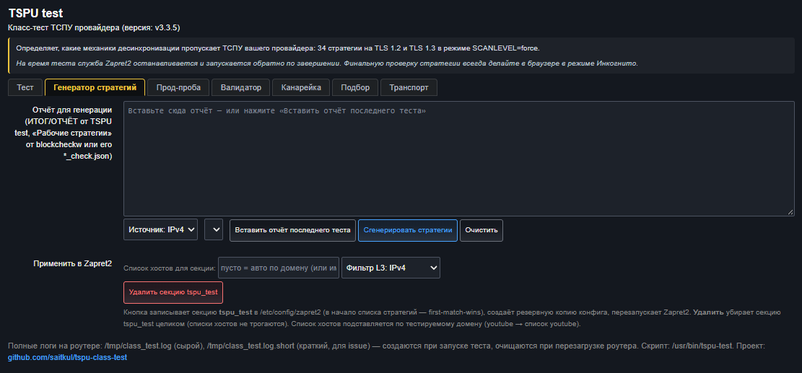
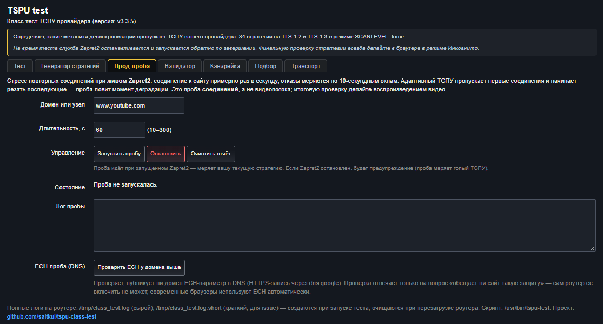
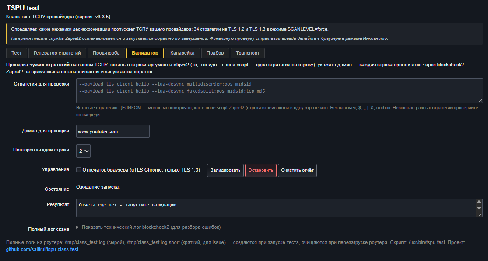
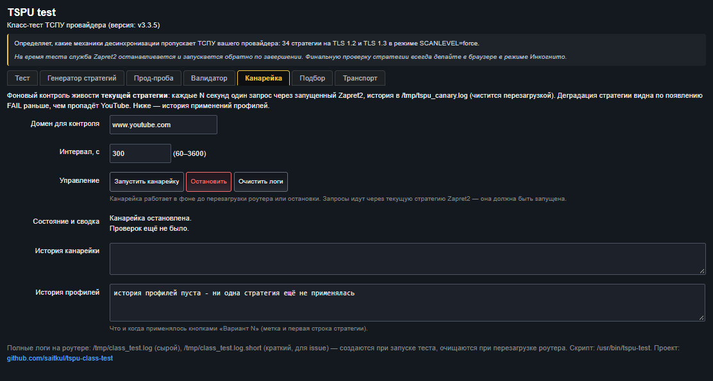
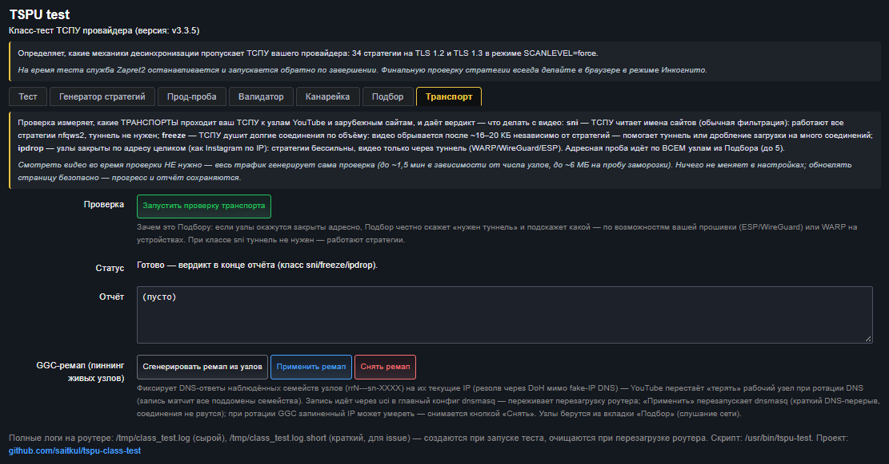
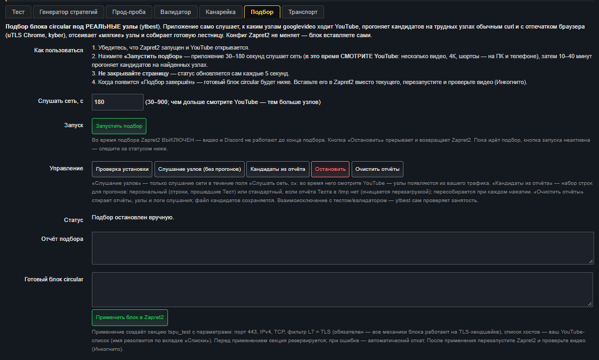

# 🔬 TSPU test 3.0 — класс ТСПУ провайдера для Zapret2

*Экспресс-диагностика фильтрации ТСПУ вашего провайдера и доведение до рабочего результата: тест определяет, какие механики пропускает ваш ТСПУ, печатает вердикт «КЛАСС ТСПУ», генерирует готовые стратегии — и новая в 3.0 **лесенка «Подбор»** сама слушает сеть, находит РЕАЛЬНЫЕ узлы вашего YouTube и собирает стратегию под них. А вкладка «Транспорт» честно говорит, когда пакетным инструментам справиться не удастся (нужен туннель).*

Проект состоит из **двух компонентов** — выберите свой:

| | Продукт | Платформа | Актуальная версия |
|---|---|---|---|
| 🧰 | **LuCI-приложение для роутера** — тест, транспорт-диагностика, подбор узлов, генератор стратегий | OpenWrt 23.05/24.x (ipk), 25.x (apk) | [**v3.0**](https://github.com/saitkul/tspu-class-test/releases/latest) — Latest |
| 💻 | **Клиенты для ПК** — тест с компьютера, пакет на роутер не нужен | Windows / Linux / macOS | [**v3.1.0-clients**](https://github.com/saitkul/tspu-class-test/releases/tag/v3.1.0-clients) |

> 📚 **Полное руководство (PDF, 14 страниц)** — в карточке релиза: установка, каждая вкладка со скриншотами, типовые сценарии, диагностика и FAQ, словарь терминов.

---

## Установка

**OpenWrt 23.05 / 24.x (opkg)** — через SSH:
```sh
curl -L -o /tmp/tspu3.ipk https://github.com/saitkul/tspu-class-test/releases/latest/download/luci-app-tspu-test_3.0_all.ipk
opkg install --force-reinstall /tmp/tspu3.ipk
```

**OpenWrt 25.x (apk)** — через SSH:
```sh
curl -L -o /tmp/tspu3.apk https://github.com/saitkul/tspu-class-test/releases/latest/download/luci-app-tspu-test-3.0.apk
apk add --allow-untrusted /tmp/tspu3.apk
```

*(загрузку по URL напрямую opkg/apk не умеют — сначала curl в /tmp, затем установка локального файла; curl входит в зависимости приложения. Альтернатива без терминала: Система → Пакеты → загрузить пакет)*

После установки выйдите из LuCI и войдите заново (или Ctrl+F5). Панель: **Службы → TSPU test**.

**Требования:** Zapret2 установленный и работающий (приложение останавливает его только на время теста и возвращает обратно); ~2,5 МБ места на роутере (пакет ~2,4 МБ — Go-бинарники utlscurl/ytsniff для отпечатка браузера и поиска узлов сжаты UPX).

---

## Как это работает: цикл за 5 шагов

1. **Тест** (5–20 мин) — классифицирует ТСПУ: какие механики десинхронизации проходят, вердикт «КЛАСС ТСПУ» отдельно для TLS 1.2 и 1.3 + «Рекомендация — с чего начать».
2. **Транспорт** (~1,5 мин, фоном) — что делать с видео: фильтрация по имени сайта (стратегии работают), душение объёма (дробление/туннель) или закрытие узлов по адресу (только туннель).
3. **Подбор** (10–40 мин, фоном) — слушает сеть, находит реальные узлы googlevideo, гоняет кандидатов на трудных узлах (в т. ч. с отпечатком браузера uTLS Chrome), собирает лесенку под ваши узлы.
4. **Генератор** — готовые профили Zapret2 одним вариантом или полным набором (10 вариантов: от минимальной до Универсальной), применение с проверкой и автооткатом.
5. **Валидатор + Канарейка** — проверка конкретной стратегии перед применением и фоновый контроль живости после.

---

## Вкладки приложения

### Тест — главный экран



Вводите домены (можно несколько через пробел — например, сайт и его узел googlevideo), жмёте **«Запустить тест»**. Zapret2 на время теста останавливается (это норма, вернётся сам), прогоняется 34 стратегии в режиме SCANLEVEL=force. В статусе видно **прогресс N/M и текущую стратегию**, есть кнопка **«Остановить»**. В конце — вердикт «КЛАСС ТСПУ» с расшифровкой и рекомендацией, проверка адаптивности (пережила ли чемпион повтор), отчёт для копирования.

### Генератор стратегий



Вставляете отчёт теста (кнопка подставляет последний) — получаете **10 готовых вариантов** профиля: Минимальная → Усиление → Оптимальная с фейком → Лестница-страховка → Дробилка → Дробилка-Лайт → Ротор (анти-адаптив) → **Универсальная** (шаблон сообщества: канон / доза-2 / без фейков). Применение одной кнопкой: с резервной копией конфига, проверкой после вставки и **автоматическим откатом при ошибке**.

### Прод-проба



Деградация при живом Zapret2: соединение раз в секунду, отказы по 10-секундным окнам. Адаптивный ТСПУ (режет длинные соединения) виден сразу. Плюс ECH-проба.

### Валидатор



Проверка ЛЮБОЙ стратегии (своей, чужой, из чата) на вашем ТСПУ: ПРОШЛА (обе версии TLS) / только TLS 1.3 / НЕ прошла, счётчик попыток «N из M» по каждой версии, вердикты «НЕСТАБИЛЬНО» и «НЕ ПРОВЕРЕНА» с разбором ошибок nfqws2 («не знает функцию — обновите zapret2»). Галочка **«Отпечаток браузера (uTLS Chrome)»** — проверка настоящим браузерным hello: убирает разрыв «тест зелёный — а в браузере не так».

### Канарейка



Фоновый контроль живости: каждые N секунд запрос через ваш Zapret2, история ОК/СБОЙ — деградация видна по FAIL раньше, чем пропадёт YouTube. Ниже — история применений профилей.

### Транспорт — диагноз первым



Измеряет, **какие ТРАНСПОРТЫ проходит ваш ТСПУ**, и даёт вердикт — что делать с видео:

| Вердикт | Что значит | Что делать |
|---|---|---|
| **sni** | ТСПУ читает имена сайтов (обычная фильтрация) | Работают все стратегии nfqws2, туннель не нужен |
| **freeze** | Долгие соединения душатся по объёму (~16–20 КБ) | Туннель или дробление загрузки на много соединений |
| **ipdrop** | Узлы закрыты по адресу целиком (как Instagram по IP) | Стратегии бессильны — видео только через туннель |

Адресная проба идёт по всем узлам из Подбора (до 5), с **дискриминатором** «SNI-фильтр или IP-дроп» (TLS с чужим именем сайта на IP узла — ICMP при этом не показатель). Проверка идёт фоном, обновлять страницу безопасно.

**GGC-ремап** (на той же вкладке) — пиннинг DNS живых узлов: YouTube перестаёт «терять» рабочий узел при ротации DNS. Запись через uci — переживает перезагрузку, снимается кнопкой.

### Подбор — лесенка под РЕАЛЬНЫЕ узлы



**Одна кнопка «Запустить подбор»** — всё остальное приложение делает само:

1. **Слушает сеть** (ЭТАП 1/2, 30–900 с): пассивный слушатель читает имена серверов googlevideo из начала соединений. **В это время смотрите YouTube на ПК и телефоне** — узлы появляются из вашего трафика. Кэш провайдера отсеивается автоматически.
2. **Прогоняет кандидатов** (ЭТАП 2/2) на трудных узлах: обычный curl и **отпечаток браузера** (uTLS Chrome). Zapret2 на это время остановлен — это норма.
3. **Отсеивает «мягкие» узлы** и собирает готовую лесенку circular. Кнопка «Применить блок в Zapret2» — с бэкапом, проверкой и откатом.

Статус-машина с явными фазами: «Сейчас тестируется: …», прогресс, честное «оборвался» с хвостом лога, если прогон умер. В «Управлении» — Слушание узлов без прогонов, очистка отчётов.

---

## Типовые сценарии

- **Первый запуск**: Тест → Генератор (Вариант «Оптимальная с фейком») → Канарейка. 15 минут до рабочего результата.
- **Видео тормозит в приложениях**: Подбор → Применить блок. Стратегия под реальные узлы, а не «среднюю температуру».
- **Отдельные видео не играют**: Транспорт → смотрите вердикт; GGC-ремап; если ipdrop — туннель.
- **Чужой конфиг из чата**: Валидатор (с uTLS-отпечатком) → применять только то, что ПРОШЛА на вашем ТСПУ.

## Безопасность

- Временные файлы только в `/tmp`; Zapret2 на время теста останавливается и запускается обратно (возврат гарантирован, даже если прогон оборвался).
- Конфигурация Zapret2 меняется только явными действиями (Применить вариант / Применить блок) — с резервной копией, проверкой и автооткатом.
- Удаление пакета полностью останавливает все фоновые инструменты, снимает GGC-ремап, возвращает Zapret2 и чистит временные файлы.

## Обратная связь

Найден баг или странность — [создайте issue](https://github.com/saitkul/tspu-class-test/issues) и приложите краткий лог из Теста (кнопка «Копировать краткий лог»). Результаты из разных городов и провайдеров особенно ценны — это карта фильтрации по стране.
